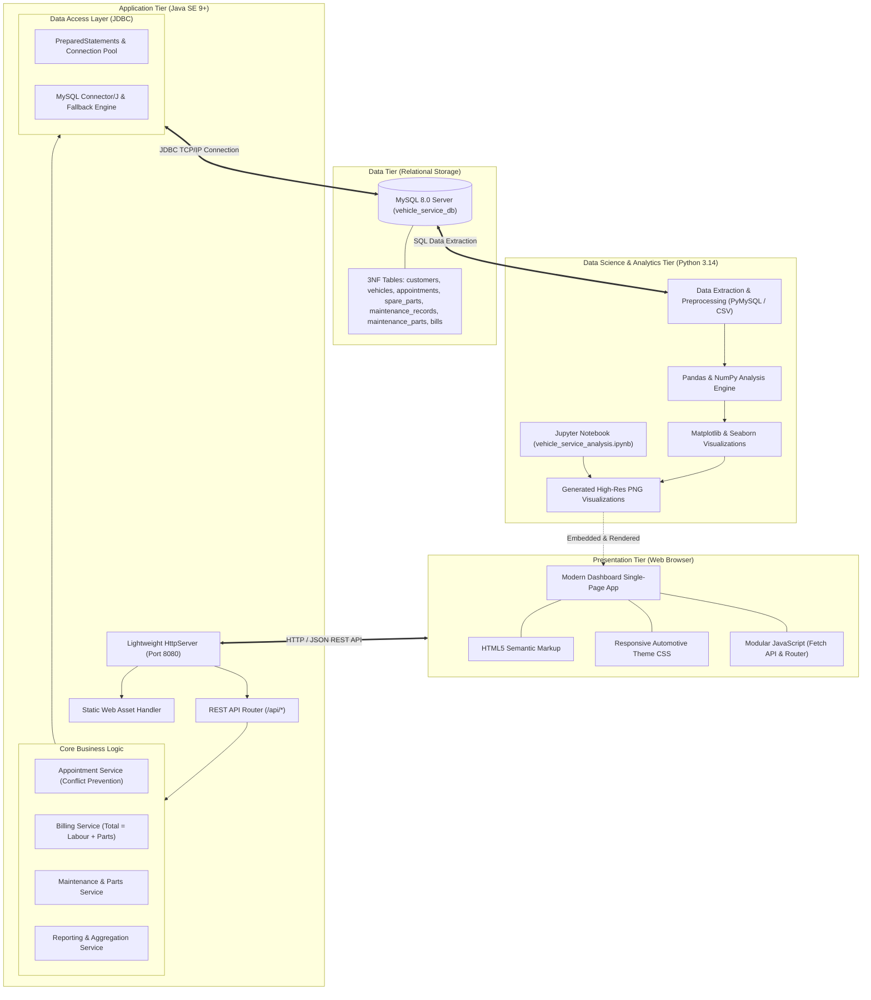

# Overall System Architecture Diagram

## 1. System Overview
The **Vehicle Service Management and Maintenance Analysis System** adopts a modern tiered enterprise architecture connecting a rich single-page client interface, a high-performance Java SE backend, an ACID-compliant MySQL relational database, and an asynchronous Python analytics engine.

---

## 2. Mermaid System Architecture Diagram

---

## 3. Tier Responsibilities

1. **Client Tier**:
   - Single-page dashboard application rendered directly by standard web browsers.
   - Handles client-side form validation, modal state management, dynamic table filtering, search, and dynamic invoice rendering.
2. **Application Tier (Java Backend)**:
   - Built on Java SE without requiring external application servers.
   - Enforces business rules: guarantees non-conflicting appointment bookings and exact financial calculations.
   - Provides thread-safe REST API endpoints and delivers static frontend assets.
3. **Data Tier (MySQL Relational Database)**:
   - Stores normalized relational data across 7 tables with strict foreign key constraints, unique indexes, and domain checks.
4. **Analytics Tier (Python / Jupyter)**:
   - Reads database tables, performs data cleansing, handles missing values, detects duplicates, calculates statistical metrics, and generates publication-grade visualizations.
