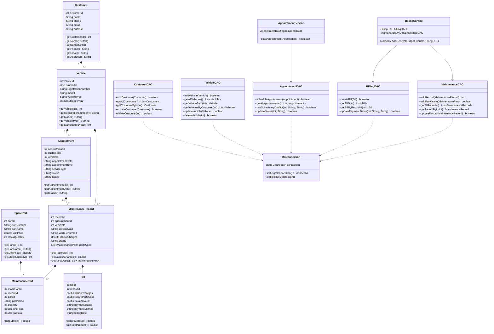

# Java OOP Class Diagram

## 1. Overview
The Java backend is designed with clean Object-Oriented principles (Encapsulation, High Cohesion, Separation of Concerns) partitioned across four clear architectural layers:
1. **Model / Domain Layer**: Encapsulated POJOs with getters, setters, and constructors.
2. **Data Access Object (DAO) Layer**: JDBC-based persistence with `PreparedStatement`.
3. **Service Layer**: Business rules, validation, scheduling conflict prevention, and bill calculations.
4. **Server & Controller Layer**: Embedded HTTP server (`com.sun.net.httpserver.HttpServer`) handling REST API requests and JSON serialization.

---

## 2. Mermaid Class Diagram

