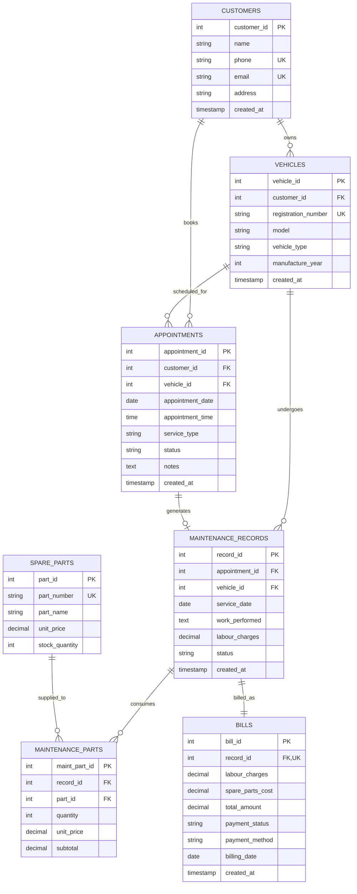

# Entity-Relationship (ER) Diagram

## 1. Overview
The **Vehicle Service Management and Maintenance Analysis System** database model is designed following Third Normal Form (3NF) relational principles to eliminate data redundancy, maintain referential integrity, and accurately model the business operations of an automobile service center.

---

## 2. Mermaid Entity-Relationship Diagram

---

## 3. Relationship Cardinalities and Constraints

| Relationship | Entities | Cardinality | Enforced Constraints |
|---|---|---|---|
| Customer owns Vehicles | `customers` &rarr; `vehicles` | 1 : N (One-to-Many) | `ON DELETE CASCADE`: Removing customer removes their vehicles. |
| Customer schedules Appointments | `customers` &rarr; `appointments` | 1 : N (One-to-Many) | `ON DELETE CASCADE` |
| Vehicle undergoes Appointments | `vehicles` &rarr; `appointments` | 1 : N (One-to-Many) | `uq_vehicle_slot (vehicle_id, appointment_date, appointment_time)` prevents double-booking. |
| Vehicle undergoes Maintenance | `vehicles` &rarr; `maintenance_records` | 1 : N (One-to-Many) | Foreign key link tracks service history per vehicle. |
| Appointment generates Maintenance | `appointments` &rarr; `maintenance_records` | 1 : 1 or 1 : 0 (Optional One-to-One) | `appointment_id` is nullable (walk-in jobs allowed), `ON DELETE SET NULL`. |
| Maintenance consumes Parts | `maintenance_records` &rarr; `maintenance_parts` &larr; `spare_parts` | M : N (Many-to-Many via Junction Table) | `quantity > 0`, `subtotal = quantity * unit_price`. `ON DELETE RESTRICT` on parts prevents deleting parts in active bills. |
| Maintenance generates Bill | `maintenance_records` &rarr; `bills` | 1 : 1 (One-to-One) | `record_id` is unique in `bills`. `chk_total_amount: total_amount = labour_charges + spare_parts_cost`. |
