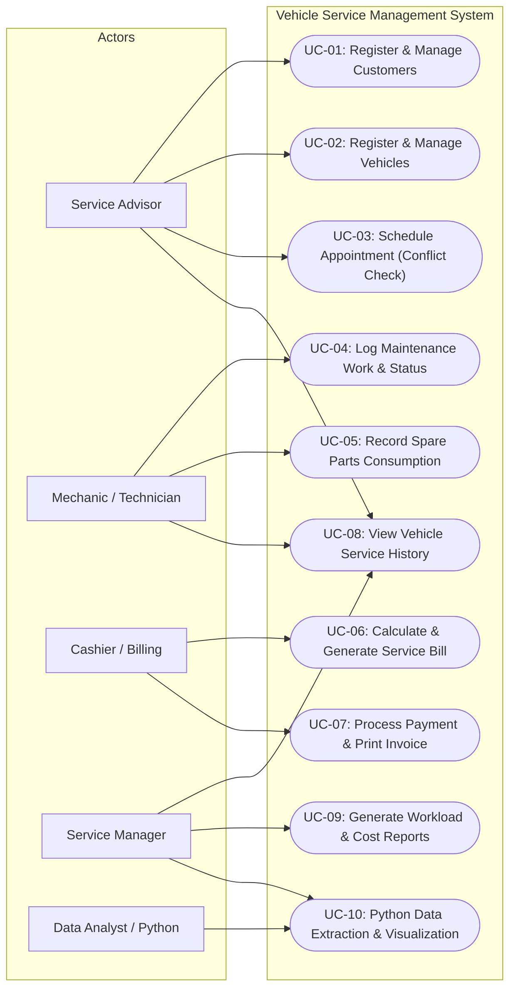

# Use Case Diagram

## 1. Actors
1. **Service Advisor / Receptionist**: Manages customer registrations, vehicle intake, and appointment scheduling.
2. **Automobile Mechanic / Technician**: Enters maintenance logs, marks work performed, and records spare parts consumed.
3. **Billing Specialist / Cashier**: Generates bills (`Total = Labour + Parts`), updates payment statuses, and prints invoices.
4. **Service Center Manager**: Analyzes workload reports, vehicle-wise maintenance expenditures, and data science insights.
5. **Data Analyst (Python Subsystem)**: Runs automated data pipelines for statistical exploration, correlation, and visualizations.

---

## 2. Mermaid Use Case Diagram

---

## 3. Core Use Case Specifications

### Use Case: UC-03 - Schedule Service Appointment
- **Primary Actor**: Service Advisor
- **Precondition**: Customer and Vehicle must be registered in the system.
- **Main Success Scenario**:
  1. Advisor enters vehicle registration or ID, requested service date, time slot, and service type.
  2. System queries existing appointments to ensure no conflict exists for the same vehicle or time slot.
  3. System saves the appointment with status `Scheduled`.
  4. Confirmation is displayed to the user.
- **Alternative Flow (Conflict Detected)**:
  1. System detects an active appointment for the vehicle at the requested slot.
  2. System rejects the booking and notifies the user with conflicting details.

### Use Case: UC-06 - Calculate & Generate Service Bill
- **Primary Actor**: Billing Specialist
- **Precondition**: Maintenance record is logged with work performed and labour charges.
- **Formula Enforced**: `Total Bill = Labour Charges + Spare Parts Costs`
- **Main Success Scenario**:
  1. Specialist selects completed maintenance record.
  2. System queries parts consumed from `maintenance_parts` and computes `spare_parts_cost = SUM(quantity * unit_price)`.
  3. System computes `total_amount = labour_charges + spare_parts_cost`.
  4. Record is saved into `bills` table, and invoice is presented.
